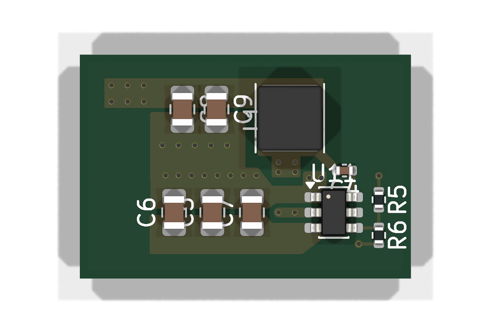

# TPS563201 buck block: 5 V → 3.3 V / 1 A

A self-contained KiCad 10 project with just the TPS563201 and its passives, as laid
out in the MultiSensors sensor node (a private repository). It
exists so the power stage can be reviewed on its own, without the rest of the board.

| File | What it is |
|---|---|
| `TPS563201.kicad_pro` / `.kicad_sch` / `.kicad_pcb` | the project (open the `.kicad_pro`) |
| `docs/TPS563201-schematic.pdf` | schematic, readable without KiCad |
| `docs/TPS563201-layout.svg` | F.Cu, B.Cu, silkscreen and outline, readable without KiCad |
| `docs/webench/` | TI WEBENCH exports the part values came from (BOM CSV, layout images) |
| `sym/Block.kicad_sym` | project-local symbols, so the project opens on any machine |

## Operating point

| | Value |
|---|---|
| Input | 4.75–5.25 V, USB-C VBUS (the connector is outside this block) |
| Output | 3.32 V (0.768 V × (1 + 33.2 k / 10.0 k)) |
| Design current | 1 A (expected load: about 100 mA average, about 570 mA peak) |
| Switching frequency | 580 kHz (TPS563201, D-CAP2, Eco-mode at light load) |
| Main loads on 3.3 V | MCU radio bursts, SCD41 CO₂ sensor (asks for a low-noise supply) |

## Parts

| Ref | Part | Value | LCSC |
|---|---|---|---|
| U11 | TI TPS563201DDCR, SOT-23-6 | | C116592 |
| L1 | Sunlord SWPA4030S3R3MT, 4 × 4 × 3 mm | 3.3 µH, Isat 3.6 A, DCR 52 mΩ | C15269 |
| C5, C6 | Samsung CL21A106KAYNNNE, 0805 | 10 µF 25 V X5R (input) | C15850 |
| C7 | 0805 | 100 nF (input, high-frequency) | |
| C8, C9 | Samsung CL21A226MAQNNNE, 0805 | 22 µF 25 V X5R (output) | C45783 |
| C4 | Samsung CL05B104KO5NNNC, 0402 | 100 nF (bootstrap) | C1525 |
| R5, R6 | 0402, 1 % | 33.2 k / 10.0 k (feedback) | |

- **L1**: at 4.75–5.25 V in, the ripple is 0.52–0.64 A peak-to-peak, so the inductor
  peaks at about 1.3 A at 1 A out.
- **Output capacitors**: two 22 µF give about 29.6 µF at 3.3 V DC bias (Samsung
  DC-bias curve), inside TI's 20–68 µF range. The Samsung part is marked NRND; its
  replacement CL21A226MAYNNN (C602037) gives about 27.4 µF.
- **C7**: optional in TI's Table 7-2, kept because the TPS563201EVM-715 fits it (C1)
  and WEBENCH reserves a spot for it.

## Board and layout

- **4 layers: F.Cu / In1 = GND plane / In2 = +3.3 V plane / B.Cu.** The inner planes
  are cut to this block's outline. In the full board they cover the whole PCB.
- All parts are on the top side, for hot-plate assembly.
- The layout follows TI SLVSD90B §7.4 (fig. 7-18) and the TPS563201EVM-715 (SLVUAK7):
  - C7 sits across U11 pins 1 (GND) and 3 (VIN), at the same 1.9 mm pitch. The SW
    node leaves between its pads, under its body.
  - C5 and C6 sit right behind C7, on shared GND / +5 V copper areas.
  - L1 is above U11. The SW node is a small island: a copper area on F.Cu, plus a
    small area on B.Cu that crosses under the GND path through vias.
  - The input and output capacitors share one GND copper area that ties into U11
    pin 1.
  - The feedback divider sits on the quiet side of U11, away from L1 and SW.
- Design rules come from MultiSensors: 0.15 mm clearance, 0.4 mm minimum on power
  nets (`TPS563201.kicad_dru`).

## Where a review would help

1. **SW copper on B.Cu.** It faces the +3.3 V plane at about 0.2 mm. It is about
   5 mm², which estimates to about 1 pF onto a heavily decoupled plane. The
   alternative is to move it onto In2, cut into the 3.3 V plane.
2. **Bootstrap path.** C4 picks up SW from the island, through a trace that runs
   about 5 mm over U11 on F.Cu.
3. **Feedback sense.** R5 measures the output through a via into the +3.3 V plane,
   not through a dedicated trace from the output capacitors (TI rule 6). R6 returns
   to GND through its own via, not a Kelvin connection to U11 pin 1 (rule 7).
4. **No series resistor on the bootstrap capacitor.** The TI EVM fits a 0 Ω (R5
   there) so the SW edges can be slowed for EMC. There is none here.

## Status

Not fabricated, not measured. The schematic passes ERC (one warning: the +5V net has
both a power symbol and a label, as in the full board). The PCB passes DRC with 0
errors, 0 unconnected items and 0 schematic/PCB mismatches.

## Source

This project is **generated** from MultiSensors with
`kicad/_generators/export_tps563201_block.py <this folder>`. The script takes values,
footprints and MPN/LCSC fields from the MultiSensors schematic, and the layout from
the user's hand-drawn U11 group in the MultiSensors board. Change the block in
MultiSensors and re-export; edits made only here are lost at the next export.
